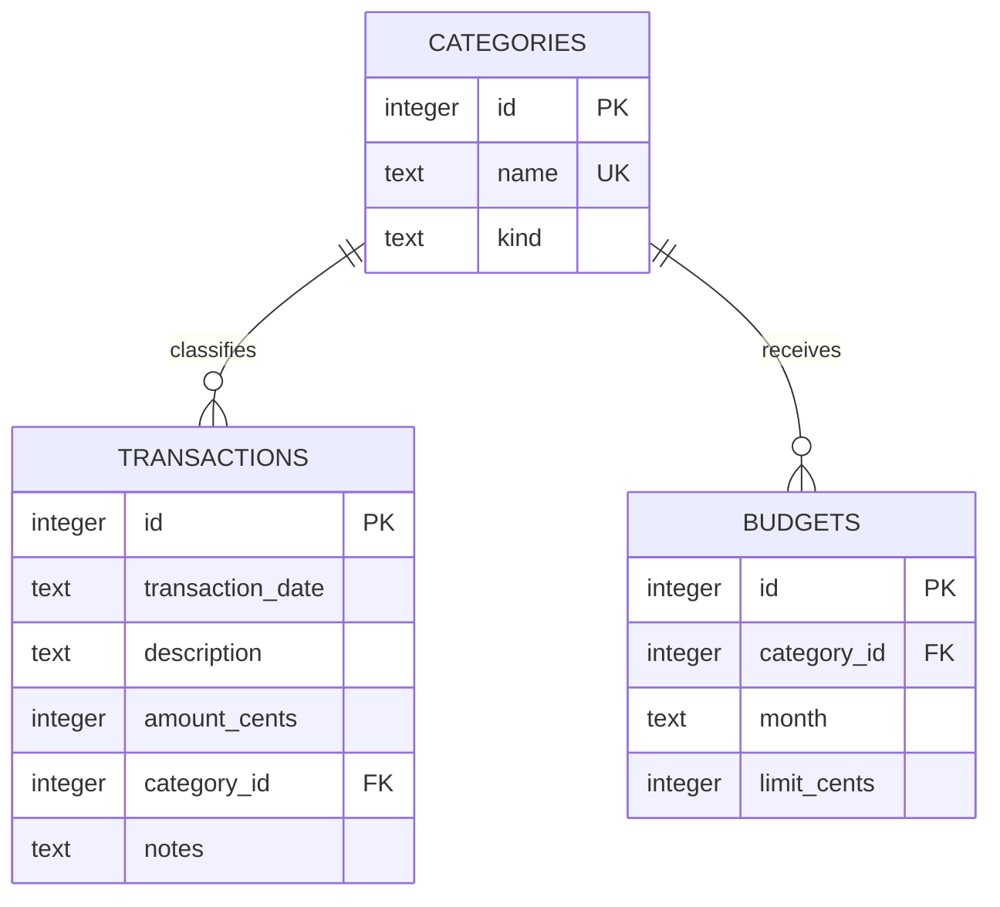

# Local Ledger

Local Ledger is a private desktop finance tracker built with Python, CustomTkinter and SQLite. It records income and expenses, sets monthly category budgets, imports bank CSV files and exports summary reports. All financial data stays in a local SQLite file on the user's computer.

## Features

- Add, view and delete income and expense transactions.
- Organise transactions using relational categories.
- Set a different limit for each expense category and month.
- See income, expenses, balance, category spending and budget progress.
- Import comma, semicolon, tab or pipe separated bank files one row at a time.
- Continue importing valid rows when malformed rows are found, then show line specific errors.
- Export monthly totals, category spending and budget remaining.
- Reject blank descriptions, invalid amounts, invalid months and future dates before a database write.
- Store money as integer pennies to avoid binary floating point rounding errors.

## Quick start

Install Python 3.11 or newer, then open a terminal in this project:

```powershell
python -m venv .venv
.venv\Scripts\Activate.ps1
python -m pip install -r requirements.txt
python run.py
```

The database is created at `LocalLedgerData/local_ledger.db` inside your user folder. To use a disposable demonstration database:

```powershell
python run.py --database demo.db
```

## CSV format

The importer requires `date`, `description` and `amount`. It recognises common alternatives such as `Transaction Date`, `Details`, `Narrative`, `Value` and `Memo`. `category`, `type` and `notes` are optional.

```csv
Date,Description,Amount,Category,Type,Notes
2026-10-01,Salary,1450.00,Salary,income,Monthly pay
2026-10-02,Supermarket,-42.73,Food,expense,Weekly shop
```

When `type` is missing, a negative amount is treated as an expense and a positive amount as income.

## Relational schema



`transactions.category_id` and `budgets.category_id` reference `categories.id`. Foreign key enforcement is enabled on every connection. The unique pair `(category_id, month)` permits only one budget for a category in a given month.

## Project structure

```text
local_ledger/
  app.py           CustomTkinter interface and event handlers
  database.py      schema, parameterised SQL and database operations
  validation.py    pure validation and money/date conversion functions
  csv_service.py   streaming import and monthly report export
tests/
  test_local_ledger.py
sample_data/
  bank_statement_example.csv
docs/
  PROJECT_EXPLANATION.md
```

## Tests

Tests use a temporary SQLite database and leave no financial data behind:

```powershell
python -m unittest discover -v
```

## Privacy and limitations

The app makes no network requests and has no analytics or account system. The database remains on the computer, but it is not encrypted. Someone with access to the Windows account and database file may be able to read it. Encryption and authenticated profiles are suitable future extensions.

## Licence

MIT. See [LICENSE](LICENSE).

